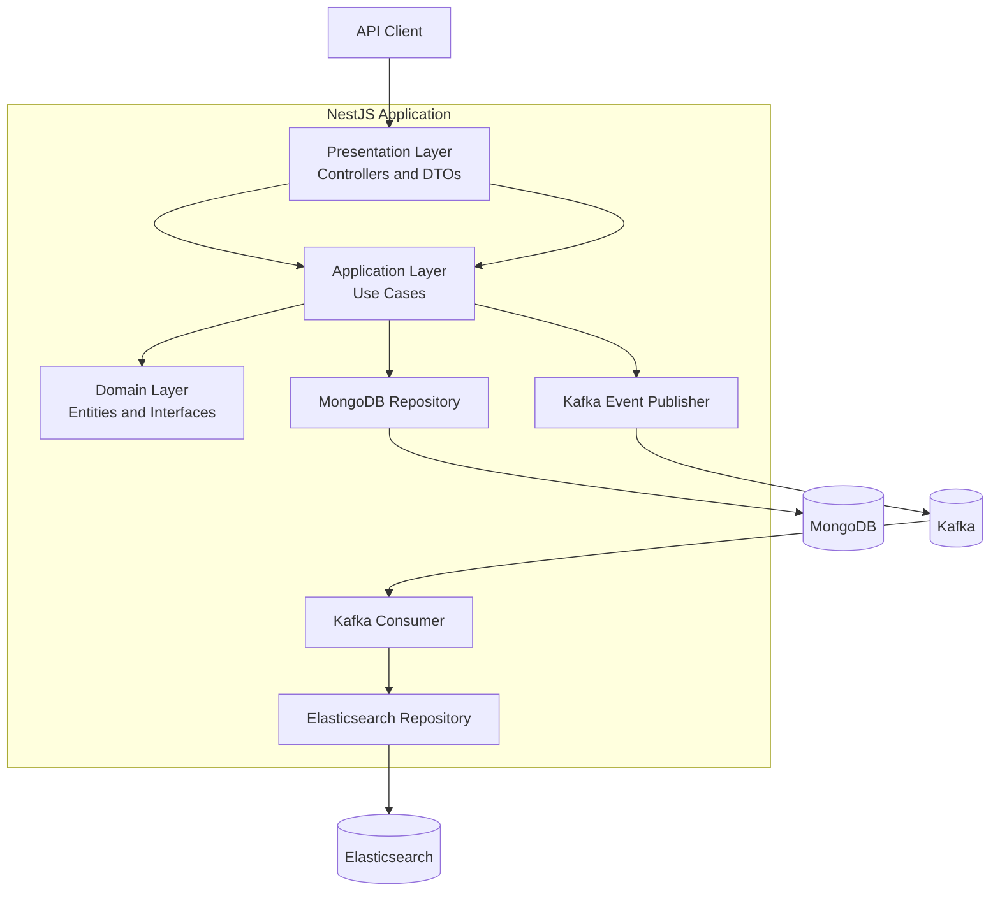
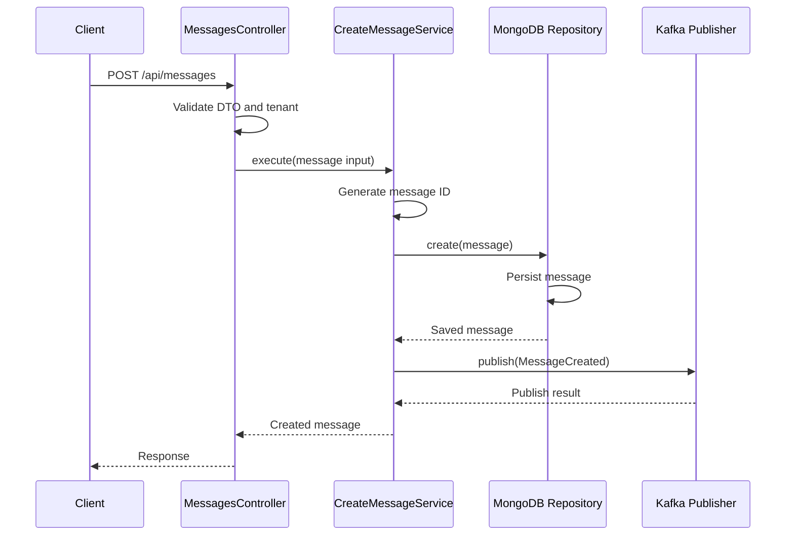
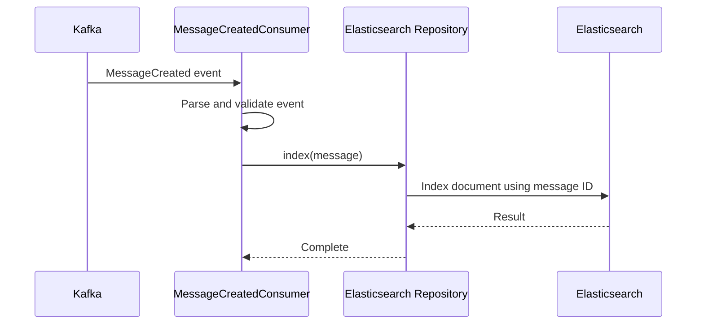

# Message Service

A multi-tenant message service built with NestJS, MongoDB, Kafka, and Elasticsearch.

The service provides APIs to create messages, retrieve conversation history, and search messages. MongoDB is the primary data store, Kafka distributes message-created events, and Elasticsearch provides full-text search.

## 1. Features

- Create messages through a REST API.
- Retrieve conversation messages with pagination.
- Search message content using Elasticsearch.
- Isolate message data by tenant.
- Publish message-created events through Kafka.
- Index messages asynchronously using a Kafka consumer.
- Use dependency injection and separated application, domain, infrastructure, and presentation layers.
- Support horizontal scaling without relying on in-memory application state.
- Validate incoming requests and reject unexpected fields.

## 2. Technology Stack

| Technology | Purpose |
|---|---|
| Node.js | JavaScript runtime |
| NestJS | Application framework |
| TypeScript | Static typing |
| MongoDB | Primary message storage |
| Mongoose | MongoDB object modeling |
| Kafka | Asynchronous event delivery |
| KafkaJS | Kafka client |
| Elasticsearch | Full-text message search |
| Jest | Unit testing |
| pnpm | Package management |

## 3. Architecture

The service uses a layered architecture inspired by Domain-Driven Design (DDD). The layers separate business operations from infrastructure and HTTP concerns without introducing unnecessary abstractions.



### Layer responsibilities

**Presentation layer**

- Defines REST controllers and request DTOs.
- Validates incoming requests.
- Extracts the tenant identifier from the request.
- Returns HTTP responses.

**Application layer**

- Implements use cases such as creating, retrieving, and searching messages.
- Coordinates repository and event-publisher interfaces.
- Contains application-level orchestration rather than HTTP or database details.

**Domain layer**

- Defines the `Message` entity and message-created event contract.
- Defines repository and event-publisher interfaces.
- Keeps application behavior independent of specific infrastructure implementations.

**Infrastructure layer**

- Implements MongoDB persistence.
- Publishes events to Kafka.
- Consumes Kafka events.
- Indexes messages in Elasticsearch.

The domain and application layers depend on interfaces. Infrastructure implementations are supplied through NestJS dependency injection.

## 4. Message Flow

### Creating a message



The message is persisted to MongoDB before its event is published.

This means MongoDB is the source of truth. Kafka and Elasticsearch support asynchronous downstream processing.

### Indexing a message



The event contains the message data required for indexing. The consumer does not need to query MongoDB to reconstruct the message.

## 5. API

All endpoints use the `/api` prefix.

### Tenant identification

Requests use the `X-Tenant-Id` header to identify the tenant.

For this coding exercise, the tenant identifier is supplied by the caller. In a production system, it should be derived from the authenticated user's identity or access token rather than trusting a caller-controlled header.

### Create a message

`POST /api/messages`

Request headers:

```http
Content-Type: application/json
X-Tenant-Id: tenant-1
```

Request body:

```json
{
  "conversationId": "conversation-123",
  "senderId": "user-456",
  "content": "Hello, world!",
  "metadata": {
    "source": "web"
  }
}
```

Example:

```bash
curl -X POST http://localhost:3000/api/messages \
  -H "Content-Type: application/json" \
  -H "X-Tenant-Id: tenant-1" \
  -d '{
    "conversationId": "conversation-123",
    "senderId": "user-456",
    "content": "Hello, world!",
    "metadata": {
      "source": "web"
    }
  }'
```

The service generates the message ID and timestamp. The message is saved to MongoDB, then a `MessageCreated` event is published to Kafka.

### Retrieve conversation messages

`GET /api/conversations/:conversationId/messages`

Query parameters:

| Parameter | Required | Default | Description |
|---|---|---:|---|
| `page` | No | 1 | Page number, starting at 1 |
| `limit` | No | 50 | Number of messages per page; maximum 100 |

Example:

```bash
curl \
  "http://localhost:3000/api/conversations/conversation-123/messages?page=1&limit=50" \
  -H "X-Tenant-Id: tenant-1"
```

Messages are returned in descending timestamp order.

The response includes the messages and pagination metadata. A typical response has this structure:

```json
{
  "data": [
    {
      "id": "message-123",
      "tenantId": "tenant-1",
      "conversationId": "conversation-123",
      "senderId": "user-456",
      "content": "Hello, world!",
      "timestamp": "2026-09-28T10:00:00.000Z",
      "metadata": {
        "source": "web"
      }
    }
  ],
  "meta": {
    "page": 1,
    "limit": 50,
    "total": 1,
    "totalPages": 1
  }
}
```

The example illustrates the response structure; actual values depend on stored data.

### Search conversation messages

`GET /api/conversations/:conversationId/messages/search`

Query parameters:

| Parameter | Required | Default | Description |
|---|---|---:|---|
| `q` | Yes | — | Full-text search term |
| `page` | No | 1 | Page number, starting at 1 |
| `limit` | No | 50 | Results per page; maximum 100 |

Example:

```bash
curl \
  "http://localhost:3000/api/conversations/conversation-123/messages/search?q=hello&page=1&limit=50" \
  -H "X-Tenant-Id: tenant-1"
```

Search is performed by Elasticsearch and is restricted to the requested tenant and conversation.

Because indexing is asynchronous, a newly created message may not be immediately searchable.

## 6. Data Model

A message contains the following fields:

| Field | Type | Description |
|---|---|---|
| `id` | String | Unique message identifier |
| `tenantId` | String | Tenant that owns the message |
| `conversationId` | String | Conversation containing the message |
| `senderId` | String | Identifier of the message sender |
| `content` | String | Message content |
| `timestamp` | Date | Message creation time |
| `metadata` | Object | Optional additional message data |

### MongoDB

MongoDB is the primary and authoritative store for messages.

The repository scopes message retrieval by both `tenantId` and `conversationId`. Pagination is implemented using `skip` and `limit`, with results sorted by timestamp descending.

A compound index supports the conversation history query:

```javascript
{
  tenantId: 1,
  conversationId: 1,
  timestamp: -1
}
```

This index helps MongoDB filter messages by tenant and conversation and return them in the requested timestamp order.

## 7. Kafka Events

### Topic

`messages.events`

### Event key

The conversation ID is used as the Kafka message key.

Using the conversation ID as the key allows Kafka to route events for the same conversation to the same partition, preserving partition-level ordering for those events.

### Consumer group

`message-search-indexer`

Kafka distributes partitions among consumer instances in the same group. This allows the indexing workload to scale horizontally, subject to the number of partitions.

### Event structure

A `MessageCreated` event contains the message data needed by the consumer.

```json
{
  "eventId": "event-123",
  "eventType": "MessageCreated",
  "version": 1,
  "tenantId": "tenant-1",
  "messageId": "message-123",
  "conversationId": "conversation-123",
  "senderId": "user-456",
  "content": "Hello, world!",
  "timestamp": "2026-09-28T10:00:00.000Z",
  "metadata": {
    "source": "web"
  }
}
```

The event includes:

- `eventId` to identify the event.
- `eventType` and `version` to identify the event contract.
- `tenantId` to preserve tenant scope.
- Message fields required to build the Elasticsearch document.

The event is self-contained so the consumer can index it without an additional database read.

## 8. Elasticsearch

Elasticsearch is used as a search index, not as the primary source of truth.

The mapping distinguishes identifiers from searchable content:

| Field | Mapping | Purpose |
|---|---|---|
| `id` | `keyword` | Exact identifier |
| `tenantId` | `keyword` | Tenant filter |
| `conversationId` | `keyword` | Conversation filter |
| `senderId` | `keyword` | Exact sender identifier |
| `content` | `text` | Full-text search |
| `timestamp` | `date` | Date filtering and sorting |

Search requests filter by tenant and conversation and perform a full-text match against message content.

The Elasticsearch document ID is the message ID. Re-indexing the same message therefore targets the same document, making the indexing operation idempotent with respect to document identity.

### Eventual consistency

MongoDB writes and Elasticsearch indexing are not part of one distributed transaction.

A successful message creation does not guarantee that the message is immediately available in search. The Kafka consumer updates Elasticsearch asynchronously, so search results are eventually consistent.

## 9. Reliability and Failure Handling

### Kafka producer

The producer connects during application initialization. If the initial connection fails, the application logs the failure and can still start. Publishing attempts handle reconnection and report failures to the caller.

### Kafka consumer

The consumer attempts to connect and subscribe to the configured topic. Connection or runtime failures are logged, and the consumer retries after a delay.

Individual message-processing failures are logged and skipped. The application does not implement an application-level retry or dead-letter queue for failed indexing.

With the current behavior, a failed indexing attempt can leave Elasticsearch behind MongoDB. A production implementation could add a retry topic, dead-letter queue, or another recovery mechanism.

### MongoDB and Kafka dual-write trade-off

Message creation currently involves two separate operations:

1. Persist the message in MongoDB.
2. Publish the corresponding event to Kafka.

These operations are not atomic. If MongoDB succeeds but Kafka publishing fails, the message remains stored but its event may not be published. A client retry could also create a duplicate message because the API does not currently implement an idempotency key.

A transactional outbox was considered but deliberately left out to keep the implementation focused on the scope of this exercise.

In an outbox design, the application would persist both the message and an outbox record in the same MongoDB transaction. A separate publisher would read pending outbox records, publish them to Kafka, and mark them as published.

This would reduce the risk of losing events between the database write and event publication. However, publishing and marking an outbox record are still separate operations, so duplicate delivery remains possible. Consumers should therefore be idempotent.

## 10. Multi-Tenancy

Every message is associated with a tenant through `tenantId`.

Tenant scope is applied to:

- Message creation.
- Conversation history retrieval.
- Elasticsearch search.
- Kafka events.
- Elasticsearch documents.

This prevents queries from intentionally crossing tenant boundaries when the correct tenant identifier is supplied.

The current exercise uses the `X-Tenant-Id` header as the tenant input. This is a demonstration mechanism, not a complete production authorization strategy. A production service should authenticate callers and derive the tenant from trusted identity claims, then enforce authorization at the API boundary.

## 11. Validation and Security

The application uses NestJS validation for incoming request DTOs.

The global validation pipe is configured to:

- Transform request values where applicable.
- Remove unknown fields only when permitted by configuration.
- Reject non-whitelisted fields.
- Validate DTO constraints such as required strings and pagination limits.

The tenant header is required by the relevant controllers. However, header validation alone does not authenticate or authorize a caller.

Production deployment should also consider authentication, authorization, rate limiting, request-size limits, secrets management, and transport security.

## 12. Scalability

The application is designed to avoid relying on process-local state for message persistence or event processing.

Multiple API instances can serve requests concurrently because messages are stored in MongoDB and events are handled through Kafka.

The indexing consumer can also run as multiple instances within the same consumer group. Kafka assigns partitions across those instances. The number of partitions limits the maximum number of consumers that can actively process partitions for that topic at one time.

Using the conversation ID as the event key helps keep events for a conversation on the same partition.

Scaling should be accompanied by appropriate MongoDB connection-pool, Kafka partition, and Elasticsearch capacity configuration.

## 13. Project Structure

```text
src/
├── config/
│   └── configuration.ts
├── messages/
│   ├── application/
│   │   ├── create-message.service.ts
│   │   ├── get-messages.service.ts
│   │   ├── search-messages.service.ts
│   │   └── *.spec.ts
│   ├── domain/
│   │   ├── entities/
│   │   │   └── message.entity.ts
│   │   ├── events/
│   │   │   ├── message-created.event.ts
│   │   │   └── message-event.publisher.ts
│   │   └── repositories/
│   │       ├── message.repository.ts
│   │       └── message-search.repository.ts
│   ├── infrastructure/
│   │   ├── messaging/
│   │   │   ├── kafka-message-event.publisher.ts
│   │   │   ├── message-created.consumer.ts
│   │   │   └── message-created.consumer.spec.ts
│   │   ├── persistence/
│   │   │   ├── message.schema.ts
│   │   │   └── mongo-message.repository.ts
│   │   └── search/
│   │       ├── elasticsearch-message.repository.ts
│   │       └── message-search.mapping.ts
│   ├── presentation/
│   │   ├── dto/
│   │   ├── messages.controller.ts
│   │   └── conversations.controller.ts
│   ├── messages.module.ts
│   └── messages.tokens.ts
├── app.module.ts
└── main.ts
```

The `test/` directory is reserved for end-to-end tests.

## 14. Local Development

### Prerequisites

* Node.js compatible with the project's dependencies
* pnpm
* MongoDB
* Kafka
* Elasticsearch

The application requires MongoDB, Kafka, and Elasticsearch to run its complete message workflow. These services can be provided locally or through a remote development environment.

### Install dependencies

Clone the repository and install dependencies:

```bash
pnpm install
```

### Configure environment variables

Create a local `.env` file using `.env.example` as a reference.

```bash
cp .env.example .env
```

Update the connection settings as needed for your environment.

The following configuration is provided in `.env.example`:

| Variable                   | Description                        |
| -------------------------- | ---------------------------------- |
| `NODE_ENV`                 | Application environment            |
| `PORT`                     | HTTP server port                   |
| `MONGODB_URI`              | MongoDB connection string          |
| `KAFKA_BROKERS`            | Kafka broker addresses             |
| `KAFKA_CLIENT_ID`          | Kafka client identifier            |
| `KAFKA_MESSAGE_TOPIC`      | Topic for message events           |
| `KAFKA_CONSUMER_GROUP`     | Consumer group for search indexing |
| `KAFKA_CONNECTION_TIMEOUT` | Kafka connection timeout           |
| `KAFKA_RETRY_INITIAL_TIME` | Initial Kafka retry delay          |
| `KAFKA_RETRY_COUNT`        | Kafka retry count                  |
| `ELASTICSEARCH_NODE`       | Elasticsearch node URL             |
| `ELASTICSEARCH_INDEX`      | Elasticsearch index name           |
| `DEFAULT_PAGE_SIZE`        | Default API pagination size        |
| `MAX_PAGE_SIZE`            | Maximum API pagination size        |

Do not commit `.env` files containing credentials or other secrets. The `.env.example` file should contain only safe example values.

### Run the application

Start the application in development mode:

```bash
pnpm start:dev
```

The API is available at:

```text
http://localhost:3000/api
```

Ensure the required infrastructure is reachable and configured before testing the complete asynchronous workflow.

### Build the application

```bash
pnpm build
```

### Run tests

Run unit tests:

```bash
pnpm test
```

Run HTTP E2E tests:

```bash
pnpm test:e2e
```

Run unit tests with coverage:

```bash
pnpm test:cov
```

The current unit and HTTP E2E tests use mocked dependencies and do not require live MongoDB, Kafka, or Elasticsearch services. Infrastructure-backed integration tests are recommended for production.

### Available scripts

| Command            | Description                          |
| ------------------ | ------------------------------------ |
| `pnpm start`       | Start the application                |
| `pnpm start:dev`   | Start in development mode with watch |
| `pnpm start:debug` | Start in debug mode with watch       |
| `pnpm start:prod`  | Start the compiled application       |
| `pnpm build`       | Compile the application              |
| `pnpm lint`        | Run Oxlint                           |
| `pnpm format`      | Format source and test files         |
| `pnpm test`        | Run unit tests                       |
| `pnpm test:watch`  | Run unit tests in watch mode         |
| `pnpm test:cov`    | Run unit tests with coverage         |
| `pnpm test:e2e`    | Run HTTP E2E tests                   |

### Running the compiled application

Build the application first:

```bash
pnpm build
```

Then start it:

```bash
pnpm start:prod
```


## 15. Testing

The project uses Jest for unit and end-to-end (E2E) testing. The test strategy focuses on verifying core business behavior, API contracts, validation, and event processing without introducing unnecessary test complexity.

### Test commands

```bash
# Run unit tests
pnpm test

# Run unit tests in watch mode
pnpm test:watch

# Run unit tests with coverage
pnpm test:cov

# Run HTTP E2E tests
pnpm test:e2e
```

### Current test coverage

The current test suite contains 18 tests across 5 test suites.

| Test type | Test suite | Tests | Purpose |
|---|---|---:|---|
| Unit | `create-message.service.spec.ts` | 2 | Verify message creation and event publishing behavior |
| Unit | `get-messages.service.spec.ts` | 1 | Verify message retrieval and pagination metadata |
| Unit | `search-messages.service.spec.ts` | 1 | Verify search delegation and returned results |
| Unit | `message-created.consumer.spec.ts` | 4 | Verify event processing, indexing, and error handling |
| E2E | `app.e2e-spec.ts` | 10 | Verify HTTP endpoints, validation, tenant header handling, and service delegation |
| **Total** | | **18** | |

All current unit and E2E tests pass, and the NestJS production build completes successfully.

### Unit tests

Unit tests focus on individual application services and the Kafka consumer. External dependencies are mocked so that tests remain fast and do not require running MongoDB, Kafka, or Elasticsearch.

**CreateMessageService**

Tests the message creation use case, including persistence and event publication behavior. This verifies the orchestration between the application service and its dependencies.

**GetMessagesService**

Verifies that the service delegates the requested tenant, conversation, and pagination parameters to the repository and returns the expected result.

**SearchMessagesService**

Verifies that search parameters are passed to the search repository and that the search result is returned correctly.

**MessageCreatedConsumer**

Tests the consumer's event-processing behavior:

- A valid `MessageCreated` event is converted into a message and passed to the search repository.
- Empty Kafka messages are logged and skipped.
- Invalid event payloads are logged and skipped.
- Elasticsearch indexing failures are logged without propagating an exception from message processing.

These tests validate the consumer's handling of individual messages. They do not test actual Kafka connectivity, consumer-group coordination, or offset behavior.

### HTTP E2E tests

The E2E suite creates a NestJS application with the actual controllers and global validation pipe. Application services are mocked, allowing the tests to exercise the HTTP layer without external infrastructure.

These tests use mocked application services and exercise the HTTP layer, including request validation and controller-to-service delegation. They do not require live infrastructure and should not be interpreted as end-to-end verification of MongoDB persistence, Kafka delivery, or Elasticsearch indexing.

The tests cover:

**Message creation**
- Successful `POST /api/messages` requests.
- Rejection of requests without the tenant header.
- Rejection of requests with missing required fields.
- Rejection of unexpected request fields.

**Conversation history**
- Successful retrieval of paginated messages.
- Correct tenant, conversation, and pagination parameters passed to the application service.
- Rejection of requests without the tenant header.
- Rejection of invalid pagination parameters.

**Message search**
- Successful search requests.
- Correct tenant, conversation, search term, and pagination parameters passed to the application service.
- Rejection of requests without the tenant header.
- Rejection of requests without a search query.

The E2E tests verify HTTP behavior and controller-to-service integration. Since the application services are mocked, they do not verify database persistence, Kafka publication, or Elasticsearch search execution.

### What the current tests do not cover

The current test suite is intentionally focused. It does not yet verify:

- MongoDB schema behavior, indexes, or actual persistence.
- Kafka broker connectivity, message delivery, partition assignment, or consumer recovery.
- Elasticsearch mappings, index creation, or real search results.
- End-to-end message propagation from MongoDB through Kafka to Elasticsearch.
- Concurrent message creation or high-volume pagination.
- Authentication and authorization. The current tenant header is a coding-exercise mechanism, not an authenticated identity.
- Application behavior under infrastructure outages and recovery.

Passing the current tests demonstrates that the tested application and HTTP behaviors work with their mocked dependencies. It does not establish production readiness or guarantee correct behavior under infrastructure failures.

### Recommended production testing strategy

For a production deployment, the test strategy should be expanded in stages.

| Test type | What it should verify | Suggested approach |
|---|---|---|
| Unit tests | Business rules, error handling, and edge cases in application services and domain logic | Jest with mocked dependencies |
| HTTP E2E tests | API contracts, validation, authentication, authorization, and tenant isolation | NestJS testing module and Supertest |
| Repository integration tests | MongoDB persistence, schema validation, indexes, sorting, pagination, and tenant-scoped queries | Test against a real MongoDB instance |
| Kafka integration tests | Event publication, consumer subscription, reconnection, delivery, and processing behavior | Test against a real Kafka broker |
| Elasticsearch integration tests | Index mappings, document indexing, tenant filters, full-text search, and pagination | Test against a real Elasticsearch instance |
| End-to-end workflow tests | Message creation, event publication, consumption, indexing, and eventual searchability | Run the application with test infrastructure |
| Failure and recovery tests | Kafka outages, indexing failures, duplicate events, and recovery behavior | Controlled infrastructure failures |
| Performance tests | Throughput, latency, concurrent requests, and resource utilization | Load-testing tools and representative workloads |
| Security tests | Authentication, authorization, tenant isolation, input handling, and abuse resistance | Automated security tests and targeted review |

### Production testing priorities

**1. Tenant isolation**

Verify that one tenant cannot retrieve or search another tenant's messages, even when the conversation ID is known. These tests should use authenticated tenant identities rather than trusting arbitrary request headers.

**2. Persistence and repository correctness**

Run repository integration tests against MongoDB to verify that stored messages can be retrieved correctly, compound indexes support the intended queries, and pagination behaves correctly with realistic data.

**3. Event delivery and indexing**

Verify that a persisted message is eventually indexed and searchable. Test duplicate event delivery to ensure the consumer's indexing operation remains idempotent.

**4. Failure recovery**

Test what happens when Kafka or Elasticsearch is unavailable. Confirm that the service behaves as documented and that failed indexing can be detected and recovered.

The current consumer logs and skips individual processing failures. A production implementation should consider retry policies, a dead-letter queue, monitoring, and a recovery process so that failed indexing does not result in permanently stale search data.

**5. Performance and scalability**

Test realistic message volumes, concurrent API requests, and search workloads. Measure API latency, database query performance, Kafka consumer lag, indexing throughput, and resource usage.

**6. Continuous integration**

Run formatting, linting, unit tests, E2E tests, and builds in the CI pipeline. Infrastructure-dependent integration tests should run in a controlled environment with predictable test data and cleanup.

### Testing philosophy

The current suite prioritizes fast, deterministic tests for core application behavior and HTTP contracts. Production testing should add confidence at infrastructure boundaries and verify that the complete asynchronous workflow remains reliable under normal operation, failures, and recovery.


## 16. Limitations and Future Improvements

The following items are intentionally outside the current implementation or are possible production enhancements:

- **Transactional outbox:** Persist messages and outbox records atomically, then publish pending events.
- **Idempotent message creation:** Support an idempotency key to reduce duplicate messages on client retries.
- **Retry and dead-letter handling:** Provide a recovery path for events that fail indexing.
- **Authentication and authorization:** Derive tenant identity from trusted credentials and enforce access policies.
- **Operational observability:** Add metrics, tracing, and dashboards for API latency, Kafka lag, indexing failures, and search performance.
- **Integration testing:** Test behavior against real or containerized MongoDB, Kafka, and Elasticsearch services.
- **Index lifecycle management:** Define index creation, versioning, and migration procedures for production.

These are deliberate scope boundaries rather than claims that the current implementation already provides those capabilities.

## 17. Design Summary

The service separates message creation from search indexing using Kafka. MongoDB remains the authoritative store, while Elasticsearch provides an asynchronously updated search projection.

The design favors:

- Clear separation of responsibilities.
- Explicit tenant scoping.
- Asynchronous processing for search indexing.
- Stateless API instances that can scale horizontally.
- Focused tests for core behavior.
- A deliberately limited implementation that leaves more advanced reliability mechanisms as documented future work.